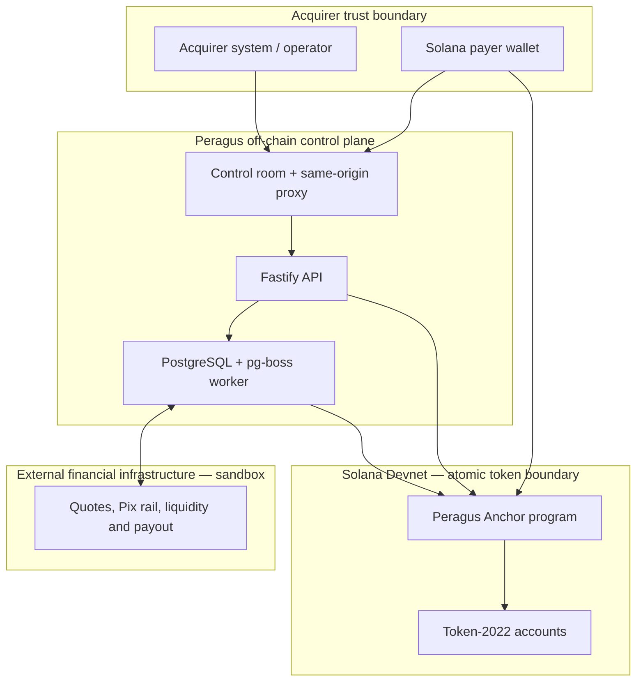
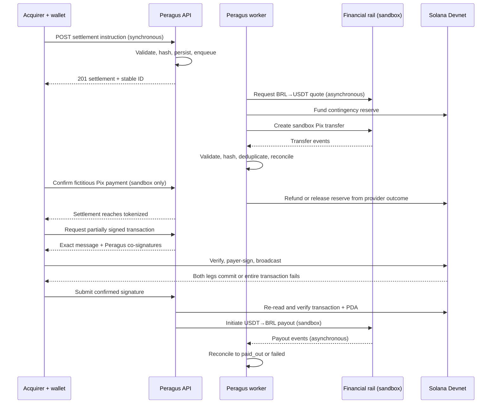

# Peragus

**On-chain Payment Processing & Settlement Infrastructure for Latin America**

Peragus is an SVM-based payment orchestration and settlement layer for acquirers,
payment processors, and other B2B payment platforms. It coordinates payment
instructions, external liquidity rails, durable reconciliation, and a two-leg
Token-2022 settlement on Solana.

The protocol is not a consumer wallet, an exchange, or a generic stablecoin
transfer interface. Its purpose is to let an acquiring participant submit a
settlement instruction, bind that instruction to exact assets, accounts,
amounts, authorities, and an expiry, and obtain independently verifiable
settlement evidence.

> **Hackathon boundary:** the public deployment uses a regulated financial
> infrastructure partner's **test environment**, simulated Pix payment
> confirmation, demo Token-2022 assets, and **Solana Devnet**. It demonstrates
> the orchestration and settlement architecture; it is not a production payment
> network and does not move real fiat.

- **Live control room:** [https://www.peragus.com.br](https://www.peragus.com.br)
- **Devnet program:** [`6Auy8BXWNaWQCAEbDkusoDkAjWvyzhkKw2LbfiVvvb1w`](https://explorer.solana.com/address/6Auy8BXWNaWQCAEbDkusoDkAjWvyzhkKw2LbfiVvvb1w?cluster=devnet)
- **Technical evidence:** [`docs/hackathon-demo.md`](docs/hackathon-demo.md)
- **Continuous integration:** [GitHub Actions](https://github.com/Peragus01/PeragusSVM/actions)

## The problem

Cross-border acquiring is commonly assembled from disconnected local payment
methods, banking partners, FX and liquidity providers, payout networks, and
internal ledgers. Each boundary introduces its own identifiers, settlement
timing, failure modes, and reconciliation process. The result is operationally
expensive infrastructure with delayed visibility, fragmented liquidity, and no
single execution record connecting payment intake to final settlement.

Peragus explores a different architecture: keep regulated fiat activity at the
financial-infrastructure boundary, while using Solana as a programmable
settlement rail between authorized participants. Off-chain state remains
durable and recoverable; the two token legs that represent the settlement
exchange execute atomically on-chain.

## What is implemented

The status labels below are used deliberately:

- **Implemented** — present in the current source tree.
- **Tested** — covered by executable automated tests.
- **Integrated** — exercised as part of the end-to-end control-room flow.
- **Sandbox** — relies on simulated or test-only external infrastructure.
- **Planned** — explicitly not implemented in this repository.

| Capability | Status | Evidence |
| --- | --- | --- |
| Corridor-bound two-leg Token-2022 settlement | Implemented, tested, integrated | [`programs/peragus`](programs/peragus), local-validator harness, Devnet transactions |
| Atomic rollback when either token leg fails | Implemented, tested, integrated | Local validator and public Devnet failure proof |
| Config authority, attestation authority, pause control, and expiry | Implemented, tested | Anchor account constraints and atomic harness |
| Token-2022 contingency reserve and deterministic vault | Implemented, tested, integrated | Program instructions, backend services, Devnet evidence |
| Idempotent settlement intake and explicit lifecycle | Implemented, tested, integrated | Fastify API, PostgreSQL repository, state-machine tests |
| Asynchronous orchestration and reconciliation | Implemented, tested, integrated | `pg-boss` queues, retry policies, workers, event persistence |
| BRL/USDT on-ramp and USDT/BRL payout | Integrated, sandbox | External provider test environment only |
| Browser wallet signing and transaction verification | Implemented, tested, integrated | Wallet Standard frontend and Devnet control room |
| Consolidated evidence endpoint | Implemented, tested, integrated | Settlement, provider-event, reserve, and Solana records |
| API authentication, tenant authorization, and rate limiting | Planned | Not present in the current API |
| HSM/KMS-backed protocol authorities | Planned | Demo currently loads sealed key material in the backend runtime |
| Production fiat processing or redemption | Planned | No production-money claim is made |
| Independent smart-contract security audit | Planned | The program has not been independently audited |

## Architecture



The browser never receives backend signing keys or provider credentials. It
receives a partially signed Solana transaction, verifies the exact message,
adds the external payer signature, and broadcasts the unchanged bytes. The API
then re-reads the confirmed transaction from Solana before advancing durable
state.

### Trust and finality boundaries

| Boundary | Guarantee in the current implementation |
| --- | --- |
| Browser → API | Typed request validation and bounded retries; no API authentication yet |
| API → database | Idempotency keys, payload hashes, optimistic versions, explicit state transitions |
| Worker → financial partner | Test credentials, validated transfer identity, event hashes, deduplication, retryable queues |
| Wallet → Solana | Exact-message verification, required signer matching, valid co-signatures, recent blockhash |
| Inside Solana transaction | Both Token-2022 legs commit or all token/account changes roll back |
| Fiat/provider operations | Asynchronous external finality; recovered through reserve, reconciliation, and terminal states—not Solana atomicity |

## On-chain settlement protocol

The program is written with Anchor and uses the Token-2022 program through
`transfer_checked` CPIs. The deployed Devnet address is declared in
[`programs/peragus/src/lib.rs`](programs/peragus/src/lib.rs) and configured in
[`Anchor.toml`](Anchor.toml).

### Program accounts

| Account | Relevant state |
| --- | --- |
| `Config` | `admin`, `attestation_authority`, `paused`, bump |
| `Corridor` | 32-byte corridor ID, source mint, destination mint, liquidity authority, bump |
| `Settlement` | Corridor, attestation authority, settlement ID, payer, recipient, both mints, liquidity authority, exact amounts, creation/expiry timestamps, `Pending` or `Settled`, bump |
| `ContingencyReserve` | Corridor, settlement ID, authorities, recipient, destination mint, vault, amount, fallback/expiry timestamps, `Funded`/`Settled`/`Refunded`, bumps |

### PDA derivation

| PDA | Seeds |
| --- | --- |
| Global config | `[b"config"]` |
| Corridor | `[b"corridor", corridor_id]` |
| Settlement | `[b"settlement", settlement_id]` |
| Contingency reserve | `[b"contingency-reserve", settlement_id]` |
| Reserve token vault | `[b"contingency-vault", settlement_id]` |

For API-created settlements, `settlement_id` is a deterministic SHA-256 digest
of the canonical backend UUID under the domain separator
`peragus:settlement:v1\0`. This binds the database identifier to a stable
32-byte PDA seed without placing a free-form identifier on-chain.

### Instructions and authorities

| Instruction | Required authority | Effect |
| --- | --- | --- |
| `initialize_config` | Program upgrade authority | Creates the singleton config and records the attestation authority |
| `create_corridor` | Config admin | Binds two distinct base-layout Token-2022 mints to one liquidity authority |
| `set_paused` | Config admin | Enables or stops settlement execution and reserve funding/settlement |
| `create_settlement` | Configured attestation authority + payer | Creates a pending, expiring settlement PDA bound to corridor parameters |
| `execute_settlement` | Payer + corridor liquidity authority | Executes both Token-2022 legs and marks the settlement settled |
| `create_contingency_reserve` | Attestation authority + payer + liquidity authority | Funds a deterministic PDA-owned Token-2022 vault |
| `settle_contingency_reserve` | Attestation authority | Releases the reserve to the recipient after the fallback time and before expiry |
| `refund_contingency_reserve` | Attestation authority before expiry; any signer after expiry | Returns reserved tokens to the corridor liquidity account |

Refund remains available independently of the pause check so recovery is not
blocked by an operational pause.

### Two-leg atomic execution

The backend constructs one legacy Solana transaction containing
`create_settlement` followed by `execute_settlement`:

```text
create Settlement PDA (Pending)
transfer_checked(source): payer             → liquidity provider
transfer_checked(destination): liquidity provider → recipient
set Settlement status = Settled
```

Leg A moves the exact source amount from the payer-owned source account to the
liquidity provider. Leg B moves the exact destination amount from the
liquidity-owned destination account to the recipient. The payer and liquidity
authority must both sign. The configured attestation authority signs the
creation instruction.

Solana transaction semantics provide the atomicity: if Leg B fails after Leg A
reaches its CPI, Leg A, the settlement PDA creation, and every other state
change in the transaction are reverted. The failed transaction may still
consume the network fee.

The public rollback demonstration intentionally requests more destination
tokens than the demo liquidity account holds. The UI then verifies from RPC
evidence that:

1. Leg A was reached.
2. Leg B failed with insufficient funds.
3. All four token-account balances are unchanged.
4. The settlement PDA is absent.
5. The backend settlement remains `tokenized`; confirmation and payout do not run.

[View the recorded failed Devnet transaction](https://explorer.solana.com/tx/YWu5hne9Fkc6qd8rjUjHNUnp62U25iTga2nMDpugBd6SMsYZPN6LM3dWoHcjWqjmAy1t5dosaTV5sDVm1paEPsg?cluster=devnet).

### Replay and mutation resistance

- A settlement PDA can be initialized only once for a successful settlement ID.
- `execute_settlement` accepts only `Pending`; a settled account returns `AlreadySettled`.
- Corridor, mints, recipient, liquidity authority, token owners, and distinct token accounts are constrained on-chain.
- Expired attestations cannot be created or executed.
- The backend leaves the payer signature slot empty while collecting the attestation and liquidity signatures.
- The browser verifies fee payer, external signer, blockhash, co-signatures, and SHA-256 message hash before opening the wallet.
- After signing, the browser rejects any wallet mutation of the serialized message.
- Backend confirmation reconstructs the expected two instructions, verifies both completion logs, checks the fee-payer signature, and verifies ownership of the resulting settlement PDA.

### Token-2022 scope

The current program intentionally accepts only base-layout Token-2022 mints.
Mint extensions such as Transfer Fee and Transfer Hook are rejected by checking
the mint account data length. Extension-aware policy is future work.

## Payment execution flow



The off-chain lifecycle is:

```text
created → awaiting_pix → pix_confirmed → tokenized → settling
        → settled → offramping → paid_out
```

`failed` and `revoked` are terminal branches. PostgreSQL constraints and the
domain state machine reject unsupported transitions.

## Contingency reserve

The reserve handles the gap between an external Pix/provider operation and the
atomic Solana settlement:

1. The worker obtains the quoted destination amount.
2. Before exposing Pix payment readiness, it transfers that amount from the
   liquidity account into a PDA-owned Token-2022 vault.
3. If the provider completes both legs, the reserve is refunded because the
   normal provider delivery succeeded.
4. If the provider fails before receiving payment, the reserve is refunded.
5. If payment was received but destination delivery fails, the reserve can be
   released to the recipient after `fallback_after` and before expiry.
6. Each resolution is terminal and recorded with its Devnet signature.

This mechanism provides recoverability across systems; it does **not** make
fiat settlement part of the Solana transaction.

## Backend and persistence

The Node.js backend uses Fastify, Zod, PostgreSQL, and `pg-boss`:

- strict request schemas and positive-u64 string validation;
- idempotent settlement creation using `request_id` plus a payload hash;
- optimistic concurrency through a database `version`;
- durable settlement, on-ramp, off-ramp, reserve, and evidence records;
- deterministic queue jobs, exponential retry, and dead-letter queues;
- normalized provider event snapshots with SHA-256 content hashes;
- identity checks across customer, wallet, quote, transfer, currency, amount,
  rail, and payout destination;
- sanitized public read models that omit payment payloads, credentials,
  customer IDs, wallet IDs, and idempotency keys.

Database migrations are versioned in [`app/backend/migrations`](app/backend/migrations).
RLS is enabled on application tables, while the backend remains the only data
access path in this demo.

## Financial infrastructure integration

The current adapter connects only to a financial infrastructure provider's
**test environment**. It supports:

- BRL-to-USDT quote and sandbox Pix on-ramp creation;
- provider-event ingestion and reconciliation;
- USDT-to-BRL quote and sandbox payout initiation;
- idempotent transfer creation and replay-safe processing;
- validation that provider objects match the persisted settlement intent.

The provider remains an external trust and settlement boundary. This repository
does not implement a KYC/KYB, AML, sanctions-screening, or KYT engine, and it
does not demonstrate a regulatory authorization held by Peragus. Those controls
must be supplied and contractually enforced by appropriately regulated
participants before any production rollout.

## Frontend control room

[`app/frontend`](app/frontend) is an English-language operator interface rather
than a consumer payment application. It provides:

- settlement creation and lookup;
- backend and Devnet health visibility;
- a clearly labeled fictitious Pix QR and sandbox confirmation action;
- Wallet Standard discovery, connect, disconnect, and exact transaction signing;
- pre-signing and post-signing transaction-integrity checks;
- persistence of signed transaction bytes for safe broadcast/confirmation recovery;
- automatic payout initiation only after the backend records `settled`;
- reserve, Solana, payout, event-hash, and consolidated-audit evidence;
- an interactive second-leg failure proof with balance and PDA verification.

The production frontend uses a same-origin `/api` route that forwards only
`/health` and `/v1/settlements/**` to the configured backend origin. Provider
credentials and protocol-authority keys remain server-side.

## Security model

### Implemented controls

- Anchor seed, address, owner, mint, signer, and account-distinctness constraints.
- Upgrade-authority-gated config initialization and admin-only corridor/pause controls.
- Dedicated attestation and corridor liquidity authorities.
- Exact amount and expiry validation on-chain and off-chain.
- Atomic rollback across both Token-2022 legs.
- PDA initialization and status-based replay prevention.
- Idempotent API intake, provider writes, queue scheduling, and confirmation.
- Exact-message verification before and after wallet signing.
- Confirmed/finalized signature checks and on-chain transaction reconstruction.
- Bounded request timeouts, sanitized browser errors, and suppressed sensitive fields.
- Environment validation that restricts the hosted demo to test credentials and Devnet.
- Local-path or sealed-base64 signer loading without key material in error messages.

### Security limitations

- **No application-layer API authentication or tenant authorization.** The
  public deployment is a constrained hackathon demo and must not be treated as
  a production API.
- **No rate limiting, abuse controls, or production-grade wallet funding policy.**
  The demo funder is capped, but the route remains test-only.
- **Backend-managed authorities use software keypairs.** Production requires an
  HSM/KMS or remote-signer implementation with rotation and access policy.
- **No independent audit.** Passing tests and Devnet evidence are not a security audit.
- **Token-2022 extensions are unsupported.** Only base-layout mints are accepted.
- **External financial finality is not atomic with Solana.** Reserve and
  reconciliation reduce operational risk but do not eliminate provider, banking,
  compliance, or counterparty risk.
- **RLS is not API authorization.** Database policies do not replace authenticated,
  scoped application access.
- **The repository is currently `UNLICENSED` and has no root `LICENSE` file.**

## Testing and verification

### CI-verified TypeScript suites

The latest audited GitHub Actions run for commit `f2220d7` completed
successfully:

| Component | Result | CI steps |
| --- | ---: | --- |
| Backend | 36 files, **239 tests passed** | script syntax checks, typecheck, tests, build |
| Frontend | 6 files, **24 tests passed** | typecheck, tests, lint, build |
| Total | **263 tests passed** | Both jobs green |

[Open CI run `38287587930`](https://github.com/Peragus01/PeragusSVM/actions/runs/38287587930).

```bash
cd app/backend
npm ci
npm run typecheck
npm test
npm run build

cd ../frontend
npm ci
npm run typecheck
npm test
npm run lint
npm run build
```

### Local-validator protocol harness

[`tests/atomic/settlement-atomic.mjs`](tests/atomic/settlement-atomic.mjs)
executes **23 checks on a fresh ledger** (21 when reusing an initialized config),
including:

- successful two-leg settlement;
- second-leg insufficient-liquidity rollback with all balances unchanged;
- expired attestation rejection;
- corridor substitution rejection;
- settled-account replay rejection;
- duplicate settlement initialization rejection;
- unauthorized payer and liquidity authority rejection;
- unauthorized pause/unpause rejection;
- paused execution with no token CPI;
- successful execution after the admin resumes the program.

The local-validator harness is separate from the current GitHub Actions workflow;
CI presently covers the backend and frontend suites, not an SBF validator job.

### Devnet evidence

| Proof | Result | Explorer |
| --- | --- | --- |
| Atomic happy path | Both Token-2022 legs finalized in one transaction | [View transaction](https://explorer.solana.com/tx/3pKHhBN9NgnNPuAEksc2LjV3jdacRteEK15UsReBJsxM88V3mnyjQxmvaySLhKqG4y7AYXSXjpCQHPuFgcwJED6V?cluster=devnet) |
| Forced second-leg failure | Transaction failed; four balances unchanged; settlement PDA absent | [View transaction](https://explorer.solana.com/tx/YWu5hne9Fkc6qd8rjUjHNUnp62U25iTga2nMDpugBd6SMsYZPN6LM3dWoHcjWqjmAy1t5dosaTV5sDVm1paEPsg?cluster=devnet) |
| Contingency reserve funding | Reserve vault funded on Devnet | [View transaction](https://explorer.solana.com/tx/3dJ1dg2DR3962HWEEyTGAdAeHQdJuqvYxmR7EnFLip9Tzny1M2npAS4V4zMd5qZqhDcUYyMuo8mHwfZwd9kaBcRd?cluster=devnet) |
| Reserve refund | Reserved amount returned after normal provider completion | [View transaction](https://explorer.solana.com/tx/LymSQRRBgn8uXNmWaYxzksCz6iVjs3oh7M95yun1iXAX7sox4aYrCPgaeaeyFM2AjsQgheEp2aMn48Lw2cjoheW?cluster=devnet) |

## Developer quickstart

### Prerequisites

- Node.js 22 or newer and npm
- Rust 1.89.0
- Solana CLI with `solana-test-validator`
- Anchor CLI compatible with the workspace
- PostgreSQL for durable backend and worker operation
- A Solana wallet extension for the browser flow

### Clone and build the program

```bash
git clone https://github.com/Peragus01/PeragusSVM.git
cd PeragusSVM

anchor build
cargo test --workspace
```

### Start a fresh local validator

The atomic harness expects RPC `127.0.0.1:18899`, faucet port `18901`, a
generated IDL, and an upgradeable deployment whose authority matches the local
admin keypair.

```bash
cd PeragusSVM

TEST_ROOT="$HOME/.local/share/peragus-local-tests"
ADMIN_KEYPAIR="$TEST_ROOT/admin-keypair.json"
mkdir -p "$TEST_ROOT/ledgers"

test -f "$ADMIN_KEYPAIR" || \
  solana-keygen new --no-bip39-passphrase --silent --outfile "$ADMIN_KEYPAIR"

ADMIN_PUBKEY="$(solana-keygen pubkey "$ADMIN_KEYPAIR")"
LEDGER="$(mktemp -d "$TEST_ROOT/ledgers/run.XXXXXX")"

solana-test-validator \
  --reset \
  --ledger "$LEDGER" \
  --bind-address 127.0.0.1 \
  --rpc-port 18899 \
  --faucet-port 18901 \
  --upgradeable-program \
    6Auy8BXWNaWQCAEbDkusoDkAjWvyzhkKw2LbfiVvvb1w \
    target/deploy/peragus.so \
    "$ADMIN_PUBKEY"
```

In a second terminal:

```bash
cd PeragusSVM/tests/atomic
npm ci
npm test
```

### Backend

```bash
cd PeragusSVM/app/backend
cp .env.example .env
npm ci
npm run db:migrate
npm run typecheck
npm test
npm run build
npm start
```

Start the asynchronous worker in a separate process:

```bash
cd PeragusSVM/app/backend
npm run start:worker
```

The complete configuration contract is documented with placeholders in
[`app/backend/.env.example`](app/backend/.env.example). Never commit `.env`, raw
keypair JSON, base64 key material, database credentials, or provider keys.

Important configuration groups:

| Group | Variables |
| --- | --- |
| Runtime | `NODE_ENV`, `HOST`, `PORT`, `LOG_LEVEL` |
| Persistence | `DATABASE_URL`, `DATABASE_SSL` |
| Jobs | `JOB_POLL_INTERVAL_SECONDS`, `JOB_CONCURRENCY` |
| Solana | `SOLANA_RPC_URL`, `SOLANA_PROGRAM_ID`, source/destination mint IDs |
| Authorities | One path **or** one sealed-base64 value for each required signer |
| Sandbox controls | Explicit demo, provider-write, co-signing, and reserve feature flags |

When the explicit sandbox demo flag is enabled, configuration validation also
requires a Devnet RPC and test-only external credentials.

### Frontend

```bash
cd PeragusSVM/app/frontend
cp .env.example .env
npm ci
npm run typecheck
npm test
npm run lint
npm run dev
```

`VITE_*` values are public browser configuration and must never contain
credentials. `PERAGUS_BACKEND_URL` is server-only and supplies the same-origin
proxy target.

## API reference

The current API has **no authentication**. Every route below is demo-only. JSON
request bodies are strict; unknown fields are rejected.

| Method | Path | Request | Successful response |
| --- | --- | --- | --- |
| `GET` | `/health` | — | Service, version, timestamp, uptime |
| `POST` | `/v1/settlements` | Settlement instruction | `201` new or `200` idempotent replay; settlement + demo funding metadata |
| `GET` | `/v1/settlements/:id` | UUID path parameter | Current settlement and version |
| `GET` | `/v1/settlements/:id/onramp` | UUID path parameter | `200` ready or `202` pending; sanitized rail state and Pix expiry only |
| `POST` | `/v1/settlements/:id/onramp/simulate-payment` | Empty body | `202`; sandbox acceptance and reconciliation scheduling |
| `POST` | `/v1/settlements/:id/solana/prepare` | Empty body | Partially signed legacy transaction, message hash, PDAs, blockhash, external signer |
| `POST` | `/v1/settlements/:id/solana/rollback-demo/prepare` | Empty body | Devnet fault-injection transaction and token accounts; sandbox only |
| `POST` | `/v1/settlements/:id/solana/confirm` | `{ "signature": "<base58>" }` | Verified signature, slot, settlement PDA, status and version |
| `POST` | `/v1/settlements/:id/offramp` | Provider-issued sandbox payout destination | `202` processing or `200` already complete; payout amounts and reconciliation metadata |
| `GET` | `/v1/settlements/:id/audit` | UUID path parameter | Sanitized consolidated evidence and completeness checks |

### Create a settlement

Amounts are positive u64 strings in base units. The corridor is exactly 32
bytes encoded as 64 hexadecimal characters.

```http
POST /v1/settlements
Content-Type: application/json

{
  "request_id": "acquirer-order-0001",
  "corridor_id": "<64-hex-character-corridor-id>",
  "payer_wallet": "<base58-solana-public-key>",
  "recipient_wallet": "<base58-solana-public-key>",
  "source_amount": "500000000",
  "destination_amount": "89550000",
  "expires_at": "<future-RFC3339-timestamp>"
}
```

```json
{
  "data": {
    "id": "<settlement-uuid>",
    "request_id": "acquirer-order-0001",
    "status": "created",
    "version": 0
  },
  "meta": {
    "idempotent_replay": false,
    "demo_wallet_funded": true,
    "demo_funding_signature": "<devnet-signature-or-null>"
  }
}
```

Reusing the same `request_id` and identical payload returns the same settlement.
Reusing it with a different payload returns `409 IDEMPOTENCY_CONFLICT`.

### Prepare, sign, and confirm

```http
POST /v1/settlements/<settlement-uuid>/solana/prepare
```

The response includes the exact `transaction_base64`, `message_hash`,
`fee_payer`, `required_external_signer`, `recent_blockhash`, and
`last_valid_block_height`. The payer signs those bytes without rebuilding the
message, broadcasts them to Devnet, and submits the resulting signature:

```http
POST /v1/settlements/<settlement-uuid>/solana/confirm
Content-Type: application/json

{
  "signature": "<base58-solana-transaction-signature>"
}
```

Confirmation succeeds only after the backend verifies the chain result against
the persisted settlement.

### Start sandbox payout and read audit evidence

```http
POST /v1/settlements/<settlement-uuid>/offramp
Content-Type: application/json

{
  "payout_destination_id": "<provider-issued-sandbox-destination-id>"
}
```

The payout can start only from `settled`; completion comes from asynchronous
reconciliation, not from the initiation response. Retrieve the final evidence:

```http
GET /v1/settlements/<settlement-uuid>/audit
```

## Hackathon scope and current status

Git history records the implementation sequence from the first Anchor checkpoint
on 4 October 2026 through cloud deployment and CI on 12 October 2026. The
repository evidence supports the following classification.

### Implemented during the recorded repository history

- Anchor settlement state, corridor binding, administrative controls, expiry,
  events, two Token-2022 legs, and contingency reserve instructions.
- Local-validator happy path, rollback, authorization, replay, pause, and
  corridor tests.
- Idempotent API intake, PostgreSQL persistence, lifecycle enforcement, queues,
  workers, provider event ingestion, on/off-ramp orchestration, and audit view.
- Browser control room, exact-message wallet signing, recovery path, sandbox
  checkout, Devnet rollback evidence, same-origin proxy, and cloud configuration.
- GitHub Actions for backend and frontend verification.

### Verified integrations

- Public control room connected to the hosted API and worker.
- PostgreSQL-backed orchestration and reconciliation.
- Finalized Devnet reserve and atomic-settlement transactions.
- Publicly inspectable failed Devnet transaction proving second-leg rollback.

### Sandbox-only capabilities

- Pix payment instruction and confirmation.
- Fiat/stablecoin quotes, transfers, and payout.
- Demo wallet funding and test-token issuance.
- Software-held backend co-signers.

### Known limitations

- No authenticated multi-tenant API or production operator controls.
- No production financial integration, real-fiat settlement, or redemption.
- No HSM/KMS authority custody or independent security audit.
- No dedicated compliance/screening implementation in this repository.
- No Token-2022 mint extensions.
- On-chain local-validator tests are not yet part of CI.
- No root license, formal API specification, threat model, or deployment runbook.

## Vision and roadmap

Peragus aims to become an interoperable payment-processing and settlement layer
for Latin American acquirers: a common integration surface across local payment
methods, regulated financial institutions, liquidity providers, and
programmable on-chain settlement.

“Mastercard-like on-chain infrastructure” is a strategic analogy for the role
of a network and orchestration layer. It is not a claim that the current
hackathon implementation has equivalent authorization, acceptance, production
coverage, risk systems, or transaction volume.

The next engineering milestones are:

1. Add authenticated tenants, scoped API keys, authorization, rate limits, and
   operational controls.
2. Replace software keypairs with HSM/KMS or policy-controlled remote signers.
3. Add an explicit provider abstraction and production-grade webhook ingestion.
4. Formalize the threat model, commission an independent program audit, and
   integrate SBF/local-validator tests into CI.
5. Define Token-2022 extension policy and add corridor governance/versioning.
6. Pilot with regulated counterparties under production compliance, treasury,
   reconciliation, and incident-response procedures.

## Repository layout

```text
programs/peragus/       Anchor settlement and contingency-reserve program
tests/atomic/           Local-validator and Devnet protocol harnesses
app/backend/            Fastify API, PostgreSQL repositories, workers and adapters
app/frontend/           TanStack Start settlement control room
docs/hackathon-demo.md  Reproducible Devnet and sandbox evidence
.github/workflows/      Backend and frontend CI
```
