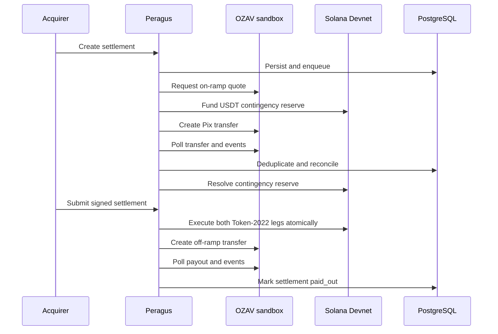

# Peragus

Peragus is a B2B cross-border settlement orchestrator for Latin America. It
coordinates regulated fiat rails with stablecoin liquidity and uses Solana as
the atomic settlement layer between an acquirer and a liquidity provider.

This repository contains the Solana program and the TypeScript orchestration
backend used for the hackathon demo. The verified demo runs against **OZAV's
test environment**, **Solana Devnet**, and PostgreSQL.

## Verified end-to-end result

On October 10, 2026, one complete roundtrip was executed and independently
queried through the audit API:

| Check | Result |
| --- | --- |
| OZAV Pix on-ramp | `completed` |
| Solana contingency reserve | `refunded` |
| Atomic Token-2022 settlement | `verified` |
| OZAV Pix off-ramp | `completed` |
| Internal settlement | `paid_out` |
| Audit warnings | none |

The run moved 500 demo mBRL into liquidity and 89.55 USDT to the recipient in
one Solana transaction. The OZAV sandbox then completed an off-ramp quote of
494.52 BRL. Every Solana signature reached `Finalized` on Devnet.

See [the full evidence record](docs/hackathon-demo.md) for transaction links,
provider event hashes, balance deltas, and reproduction commands.

## Architecture



### Atomicity boundary

The two Token-2022 legs execute inside one Solana transaction: either the
source token reaches the liquidity provider and USDT reaches the recipient, or
both transfers revert. Fiat and provider operations cannot share that same
transaction boundary, so Peragus coordinates them with a contingency reserve,
a durable state machine, idempotent event ingestion, and retryable workers.

## Core guarantees

| Area | Implementation |
| --- | --- |
| On-chain settlement | PDA-bound amounts, mints, token accounts, authorities, expiry, and replay protection |
| Contingency liquidity | USDT is reserved before Pix instructions are released and later settled or refunded |
| Provider reconciliation | OZAV transfer snapshots are validated, normalized, hashed, deduplicated, and reconciled |
| Durable orchestration | PostgreSQL plus `pg-boss` retries, exponential backoff, and dead-letter queues |
| State safety | Explicit transitions from `created` through `paid_out`, `failed`, or `revoked` |
| Auditability | One sanitized endpoint joins settlement, on-ramp, reserve, Solana, off-ramp, and event evidence |

## Technology

- Solana program with Anchor and Token-2022
- TypeScript, Node.js 22+, Fastify, and Zod
- PostgreSQL and `pg-boss`
- OZAV test API for Pix on-ramp and off-ramp
- Vitest: 221 tests across 33 test files

The Devnet program ID is:

```text
6Auy8BXWNaWQCAEbDkusoDkAjWvyzhkKw2LbfiVvvb1w
```

## Backend setup

Create a local environment file and fill in only test or Devnet values. Never
commit `.env` or local keypairs.

```bash
cd app/backend
cp .env.example .env
npm ci
npm run db:migrate
npm run typecheck
npm test
npm run build
```

Run the API and worker in separate terminals:

```bash
cd app/backend
npm start
```

```bash
cd app/backend
npm run start:worker
```

## Demo commands

```bash
# Prepare a Pix-expiry scenario, then watch the returned settlement ID.
npm run demo:pix-expiry:prepare
npm run demo:pix-expiry:watch -- <settlement_id>

# Simulate Pix payment only in the OZAV test environment.
npm run demo:pix-success

# Execute Pix -> Solana -> Pix.
npm run demo:offramp -- <ozav_payout_destination_id>

# Print the sanitized evidence bundle for any persisted settlement.
npm run demo:audit -- <settlement_id>
```

The roundtrip demo never prints a Pix key, QR payload, API credential, or
idempotency key.

## HTTP surface

| Method | Route | Purpose |
| --- | --- | --- |
| `GET` | `/health` | Process health |
| `POST` | `/v1/settlements` | Create an idempotent settlement |
| `GET` | `/v1/settlements/:id` | Read settlement state |
| `GET` | `/v1/settlements/:id/onramp` | Read the persisted Pix on-ramp instructions |
| `POST` | `/v1/settlements/:id/solana/prepare` | Build the partially signed Solana transaction |
| `POST` | `/v1/settlements/:id/solana/confirm` | Verify and persist the confirmed transaction |
| `POST` | `/v1/settlements/:id/offramp` | Initiate the OZAV off-ramp |
| `GET` | `/v1/settlements/:id/audit` | Read sanitized, consolidated evidence |

## Security and deployment status

This is a hackathon-grade integration, not a production deployment:

- OZAV writes are restricted to test credentials and are rejected in
  production mode.
- Local Solana keypair co-signers are rejected in production mode; production
  requires an HSM/KMS signer adapter.
- The API currently has no application-layer authentication. Keep it bound to
  localhost or a private network until authentication and authorization are
  added.
- The on-ramp read route contains Pix payment instructions and must not be
  exposed publicly without access control. The audit route deliberately omits
  QR bodies, Pix codes, provider credentials, customer IDs, wallet IDs, and
  idempotency keys.
- Devnet tokens, sandbox balances, and simulated Pix payments have no monetary
  value.
